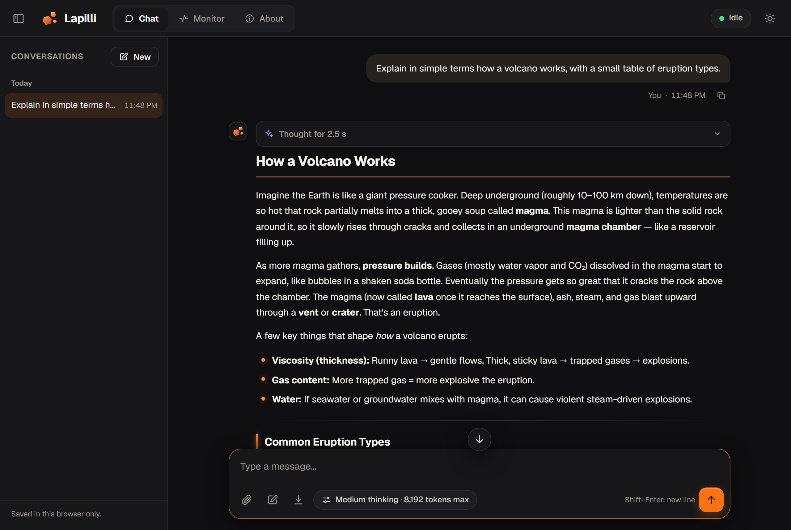
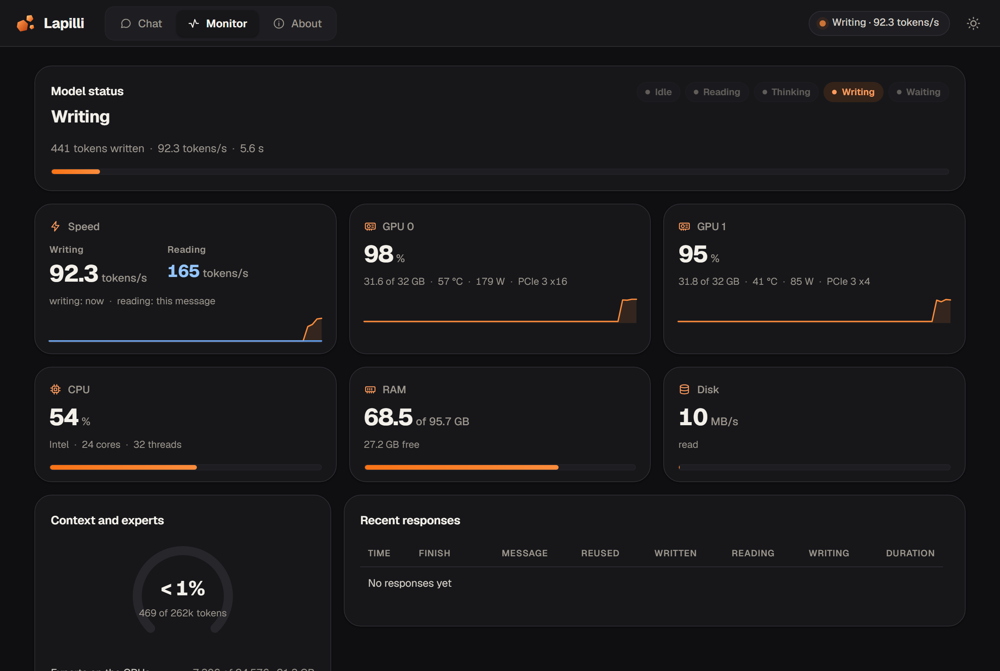
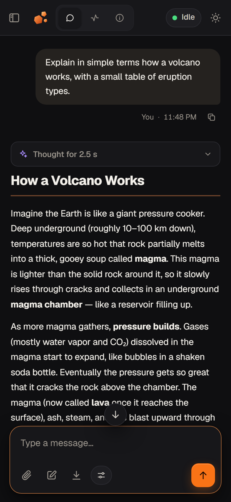

# Lapilli : Basalt sur NVIDIA V100

Lapilli est un portage de [Basalt](https://github.com/jesdga95/basalt), le moteur d'inférence local de **Qwen3.8-Flash-Next**,
pour les cartes **NVIDIA V100** (Volta, compute capability 7.0). Basalt ne vise que Blackwell (sm_120) et n'accepte pas
d'autres architectures ; ce fork ajoute sm_70 et garde la compilation Blackwell telle quelle.

Il apporte aussi une page de discussion, servie à `/` : conversations, niveaux de réflexion, images, appels d'outil affichés
en cartes, et un moniteur des cartes graphiques en direct. Le tableau de bord de Basalt passe à `/dashboard`. Le serveur
garde les API OpenAI et Anthropic de Basalt.

*Les lapilli sont les petits fragments que projette un volcan : de petits morceaux de basalte.*

<p align="center"></p>
<p align="center">&nbsp;&nbsp;</p>
<p align="center"><sub>La page de discussion, le moniteur en direct pendant l'écriture d'une réponse, et la même page sur un téléphone. Captures de cette version sur deux V100.</sub></p>

> Fondé sur le commit `6809edfa` de Basalt (15 novembre 2026). Basalt évolue vite ; ce fork en est une photo figée et ne suit
> pas ses mises à jour. Fourni tel quel, sans support (voir [Support](#support)).

## Ce qui a été mesuré

Une machine : 2 V100-SXM2 32 Go (sur des liens PCIe 3.0 x16 et x4, pair à pair coupé : voir plus bas), Intel Core i9-14900K,
96 Go de RAM, Windows 10, CUDA 12.6, pilote NVIDIA 561.17, le pack `Qwen3.8-FN-UD-Q4_K_XL` (115 Go) sur un SSD NVMe, experts
projetés en mémoire. Mesuré le 20 novembre 2026, avec la compilation de ce dépôt ; chaque vitesse est la médiane de trois
passages. Strata v0.2.13, le moteur pour V100 dont Basalt descend, a passé les mêmes mesures sur la même machine auparavant.

| | Lapilli | Strata v0.2.13, même machine |
|---|---|---|
| Écriture, réponse courte (256 jetons, température 0) | 91 jetons/s | 58 à 72 jetons/s |
| Écriture, longue réponse avec réflexion (1 500 jetons) | 140 jetons/s (133 à 145) | 68 à 94 jetons/s |
| Lecture d'un message de 3 000 jetons | 1 295 jetons/s | |
| Lecture d'un message de 4 200 jetons | 1 170 jetons/s | 250 à 490 jetons/s |
| Lecture d'un message de 8 000 / 16 000 jetons | 1 504 / 1 448 jetons/s | |
| Chargement du modèle | 34 s | |

Justesse, avec la porte de Basalt (`basalt-bench --quality 100`, 100 morceaux par le chemin de décodage, contre la référence BF16) :

| | Lapilli sur 2 V100 | Chiffres publiés par Basalt pour ce pack (RTX 5090) |
|---|---|---|
| Perplexité | 3,3206 | 3,321 |
| KLD moyenne | 0,04932 | 0,0496 |
| Même premier choix | 92,75 % | 92,63 % |

Le portage garde la qualité du pack. 108 des 122 essais de parité GPU de Basalt passent sur une V100 ; les autres essaient des
chemins qu'une V100 ne prend pas avec ce pack : des noyaux propres à Blackwell (FP8, FP4, TMA), les groupes de blocs (le moteur
prend son chemin de repli), plus de 96 Ko de mémoire partagée par bloc, et deux comparaisons au bit près entre des chemins qui
n'additionnent pas dans le même ordre sur Volta.

## Prérequis

- Une ou plusieurs NVIDIA V100. Essayé : deux V100-SXM2 32 Go.
- Windows 10 ou 11 x64. Linux n'est pas essayé (voir [Pas essayé](#pas-essayé)).
- CUDA Toolkit 12.6 à 12.9 (CUDA 13 a abandonné Volta), les Build Tools de Visual Studio 2022 (C++), CMake 3.24+, Python 3.10+.
- De la RAM et un SSD rapide pour les experts qui ne tiennent pas en VRAM : le pack fait 115 Go. Essayé avec 96 Go de RAM.
- Un pack en K-quant. Les packs NVFP4 exigent du FP4 matériel et ne tournent pas sur V100. Essayé : `Qwen3.8-FN-UD-Q4_K_XL`.

## Archive prête à l'emploi (Windows)

Chaque version publiée porte `lapilli-v100-<tag>-windows-x64.zip` : `bin\` (`basalt`, `basalt-bench`, `basalt-probe`,
`basalt-vision`), le serveur, la page de discussion, `data\`, `docs\`, `requirements.txt` et les licences. Comme celles de
Basalt, elle ne contient aucune bibliothèque CUDA ni environnement Python. Il faut :

- Un pilote NVIDIA qui gère CUDA 12.6 (essayé : 561.17).
- Les bibliothèques d'exécution de CUDA 12 dans le `PATH` : `cudart64_12.dll`, `cublas64_12.dll` et `cublasLt64_12.dll`.
  Le CUDA Toolkit 12.6 à 12.9 les installe.
- Le Microsoft Visual C++ 2015-2022 Redistributable (x64).
- Python 3.10+ avec les dépendances dans un `.venv` en tête de l'archive, que `bin\basalt.exe serve` utilise quand il est là :
  `py -3 -m venv .venv` puis `.venv\Scripts\pip install -r requirements.txt`.

Ensuite, voir [Lancer](#lancer).

## Compiler (Windows)

Depuis une *x64 Native Tools Command Prompt for VS 2022* :

```bat
git clone <l'adresse de ce dépôt> lapilli && cd lapilli
cmake -S . -B build70 -G Ninja -DCMAKE_BUILD_TYPE=Release -DCMAKE_CUDA_ARCHITECTURES=70 -DBASALT_MODELS=qwen4exp -DCMAKE_CUDA_RUNTIME_LIBRARY=Shared
cmake --build build70
py -3 -m venv .venv
.venv\Scripts\pip install -r requirements.txt
```

Les programmes arrivent dans `bin\`. Une compilation complète, essais compris, a pris 49 minutes sur un i9-14900K de 24 cœurs,
avec 6 tâches en parallèle.

## Lancer

```bat
hf download jesdga/Qwen3.8-Flash-Next-Basalt Qwen3.8-FN-UD-Q4_K_XL.basalt --local-dir models
bin\basalt.exe serve models\Qwen3.8-FN-UD-Q4_K_XL.basalt --gpu 0,1 --kv int8 --mmap-experts --resident-experts --peer-exclusive --vram-reserve-mib 700 --ram-reserve-mib 16384 --max-context 262144 --vision dynamic --port 8080
```

Puis ouvrir `http://127.0.0.1:8080/`. Toutes les options sont celles de Basalt : voir ses pages [running](docs/running.md) et
[configuration](docs/configuration/index.md) (le dossier `docs/` est la documentation de Basalt, écrite pour Blackwell).

## Ce qui change par rapport à Basalt

- **Compilation** : compute capability 7.0 acceptée à côté de 12.0, avec CUDA 12.6 ou plus récent.
- **Une couche de compatibilité** (`include/basalt/kernels/volta_compat.cuh`) : chaque instruction PTX récente qu'utilise le
  moteur reçoit un équivalent juste pour sm_70 ; tous les noyaux compilent et calculent juste sur une V100.
- **Des chemins V100 pour les noyaux chauds** : le chemin dp4a de llama.cpp pour les produits quantifiés de la lecture ;
  l'attention int8 de la lecture sur les tensor cores de la V100 (`mma.m8n8k4`, repris de Strata) ; les lectures
  d'hyper-connexion, le routeur, les experts du décodage et la récurrence GDN réécrits pour Volta ; l'échange des experts
  entre deux cartes réglé pour V100.
- **Le pair à pair est coupé par défaut sur Volta** : sur la machine d'essai, les copies directes entre les deux V100 rendaient
  des données fausses. Les copies passent par la mémoire de l'hôte. `BASALT_PEER_NO_P2P=0` le rallume, à vos risques.
- **Serveur** : la reprise exacte d'une suite de conversation (les jetons de la réponse précédente sont repris tels qu'ils
  ont été tirés : le moteur retrouve toujours son cache).
- **La page de discussion Lapilli** à `/` ; le tableau de bord de Basalt à `/dashboard`.

Les variables d'environnement `BASALT_*` ajoutées par le portage sont les interrupteurs A/B des mesures ; leurs valeurs par
défaut sont les meilleures mesurées sur V100, ce ne sont pas des réglages.

## Pas essayé

Une seule V100 ; les V100 16 Go ou PCIe ; NVLink avec le pair à pair allumé ; Linux (le code est portable comme celui de Basalt,
mais le portage n'a été compilé et lancé que sous Windows) ; d'autres packs que `UD-Q4_K_XL` ; les autres modèles de Basalt
(DeepSeek-V4.1-Flash et Qwen3.8-27B ne sont pas compilés : `-DBASALT_MODELS=qwen4exp`) ; la compilation Blackwell de ce fork.

## Support

Ce fork est partagé tel quel, en espérant qu'il serve à d'autres possesseurs de V100. Aucune promesse de support ni de mise à
jour. Les issues pourront être lues, sans garantie de réponse.

## Remerciements et licence

MIT, comme Basalt ([LICENSE](LICENSE)). Lapilli repose sur le travail d'autres :

- [Basalt](https://github.com/jesdga95/basalt) de Jesús Gulfo (MIT) : le moteur.
- [Strata](https://github.com/Niko1221/Strata) de Niko1221 et des contributeurs de Strata (MIT) : l'origine de Basalt, et le
  noyau d'attention V100 repris ici.
- [llama.cpp / ggml](https://github.com/ggml-org/llama.cpp) (MIT) : les produits dp4a de la lecture.
- [marked](https://github.com/markedjs/marked) (MIT) : la mise en forme du texte de la page. Police Geist (SIL Open Font License).

Toutes les notices sont dans [THIRD_PARTY_LICENSES](THIRD_PARTY_LICENSES).

English: [README.md](README.md).
